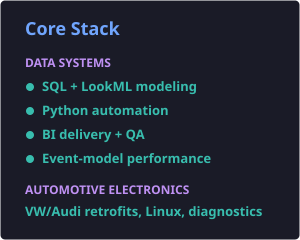

<h1 align="center">Darrian</h1>

  <strong>Business Intelligence &nbsp;•&nbsp; Data Systems &nbsp;•&nbsp; Automotive Electronics</strong>

  I build BI and data engineering systems for large scale operational platforms: SQL, LookML, backend logic, QA workflows, and performance tuning across high volume datasets. Outside of work, I build Linux desktop tools and work on VW/Audi electronics, diagnostics, and reverse engineering.

  
  
  
  
  

  
  

## Showcase: RoomCall

  

  <strong><a href="https://github.com/daredoole/RoomCall">RoomCall</a>: push-to-talk intercom for Home Assistant, on the speakers you already own.</strong> 
  Hold a button, talk, and your voice plays in the room you picked on Sonos, AirPlay, and Google Cast speakers.

  
  
  

  
  &nbsp;
  
  &nbsp;
  

- **Rooms are your Home Assistant areas**: call one room, the whole house, or a person wherever they are.
- **Talk, Type, or Ask**: live voice, text-to-speech, or a question answered from an Assist satellite, with replies aimed back at the caller.
- **Announcements and tasks**: scheduled or triggered announcements that keep reminding until someone confirms the chore is done.
- **Quiet hours, Do Not Disturb, doorbell answering, and call history with transcripts**, plus a sideloadable native iOS app and Siri Shortcuts.

## Tools I'm Proud Of

These are some of the projects I've put the most work into: practical tools for Linux, measured audio, home automation, and VW/Audi electronics.

### Linux Desktop and Setup

| Project | What it does |
| --- | --- |
| [inputflow-linux](https://github.com/daredoole/inputflow-linux) | Native C++17 Linux client for Microsoft PowerToys Mouse Without Borders. Shares mouse, keyboard, and clipboard across machines, with automatic reconnect, a tray and dashboard, and an Android peer. |
| [fedora-glow-kit](https://github.com/daredoole/fedora-glow-kit) | Fedora setup starter kit with CLI tools, terminal polish, and KDE options, built around backups, reversible installs, and clear credits. |

### Audio and Home Automation

| Project | What it does |
| --- | --- |
| [audio-calibration-mcp](https://github.com/daredoole/audio-calibration-mcp) | Cross-platform MCP server for REW measurements and speaker, room, and car calibration, with conservative EQ, JamesDSP and CamillaDSP workflows, and measured verification. |
| [airplay-esp32](https://github.com/daredoole/airplay-esp32) | AirPlay 2 receiver for ESP32-S3 and PCM5102A, with per-channel parametric EQ, REW import, Audio Calibration MCP, a web UI, MQTT, and Home Assistant integration. Fork of [rbouteiller/airplay-esp32](https://github.com/rbouteiller/airplay-esp32). |
| [spatial-presence](https://github.com/daredoole/spatial-presence) | Local-first Home Assistant floorplan editor and live presence map that brings multiple mmWave radars into one view. |

### Automotive Tooling

| Project | What it does |
| --- | --- |
| [MMI3G-Toolkit](https://github.com/daredoole/MMI3G-Toolkit) | Modular SD card toolkit for Audi/VW MMI 3G, MMI 3G+, and RNS-850 infotainment systems. Fork of [dspl1236/MMI3G-Toolkit](https://github.com/dspl1236/MMI3G-Toolkit). |

## Selected Automotive Work

| Project | Focus | Link |
| --- | --- | --- |
| RNS850 LAN Activation / Google Earth Restoration | Reverse engineering encrypted scripts and building a stable RNS850-focused LAN activation process | [Write-up](https://www.clubtouareg.com/threads/enabling-rns850-google-earth-via-lan.307124/) |
| Touareg 7P Electronics and Retrofits | Lift, ambient lighting, FlexRay steering research, and router-to-MMI gateway setup | [Build thread](https://www.vwvortex.com/threads/darrian%E2%80%99s-2016-touareg-adventures.9535962/) |
| Audi B5 2.0 Stroker Build | Mechanical work, wiring, ECU, standalone tuning, hardware, and restoration | [Build thread](https://www.vwvortex.com/threads/darrian%E2%80%99s-b5-2-0-stroker-build.9496093/) |

  

